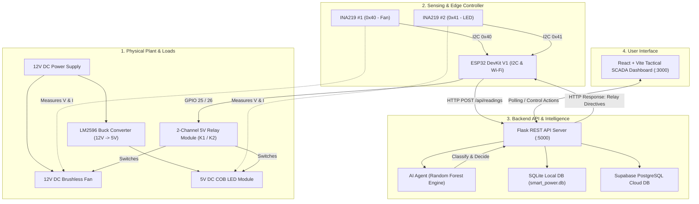
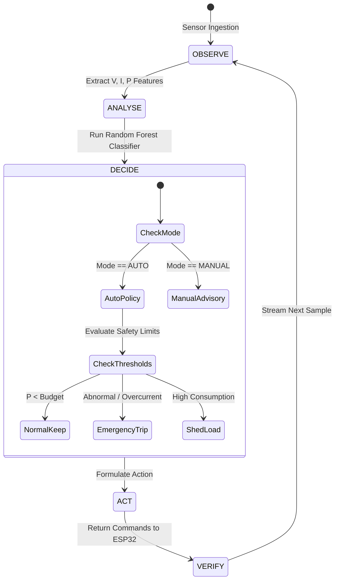

# SYSTEM ARCHITECTURE & DATA FLOW
## Smart Power Optimization System Using AI Agents

---

## 1. END-TO-END SYSTEM TOPOLOGY

---

## 2. CLOSED-LOOP AI AGENT WORKFLOW

---

## 3. COMPONENT LAYERS

### Layer 1: Hardware & Sensing
- **INA219 Sensor 1 (`0x40`):** Samples 12V Fan voltage (0–26V) and current (mA) across an onboard 0.1Ω shunt resistor.
- **INA219 Sensor 2 (`0x41`):** Samples 5V COB LED voltage and current post-buck conversion.
- **Relay Module:** Optocoupled galvanic isolation between 3.3V ESP32 and high-current 12V/5V DC circuits.

### Layer 2: ESP32 Firmware
- Non-blocking telemetry loop posting every 2000ms.
- Reads JSON response from `/api/readings` and dynamically executes `commands.fan_relay` and `commands.led_relay`.
- Auto-reconnect watchdog for robust wireless communication.

### Layer 3: Backend REST Services
- Ingests telemetry, computes total power and cumulative energy (Wh / kWh) using trapezoidal integration.
- Orchestrates persistent dual-storage: writes locally to SQLite and syncs to Supabase Cloud when configured.

### Layer 4: AI Decision Engine
- 100-tree Random Forest Classifier trained on 9 operational features.
- Safe deterministic rule fallback if model file is missing or confidence is low.
- Generates transparent, explainable recommendations and rationales.

### Layer 5: SCADA Web Presentation
- Built with React, Vite, Tailwind CSS, Recharts, and Lucide icons.
- Displays live HUD metrics, real-time power charts, individual load actuator toggles, and autonomous AI decision logs.

